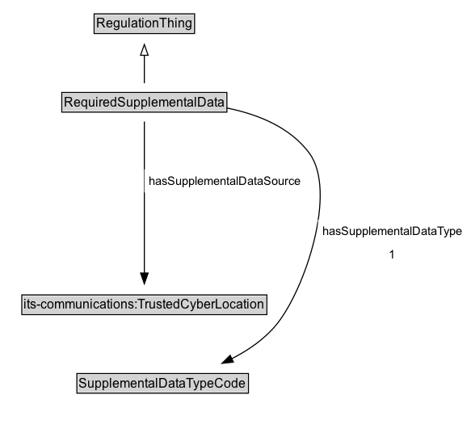

# RequiredSupplementalData

Data that a METR user system needs from a supplemental data provider to determine the current applicability of a regulation.

EXAMPLE: To determine if a time-based parking restriction is currently active, a METR user system needs to know the current date and time.

**IRI**: `https://w3id.org/itsdata/regulation/v1/RequiredSupplementalData`

## Diagram

=== "SVG (interactive)"

    <!-- Generated by graphviz version 14.1.3 (20260303.0454)
     -->
    <!-- Pages: 1 -->
    <svg width="437pt" height="394pt"
     viewBox="0.00 0.00 437.00 394.00" xmlns="http://www.w3.org/2000/svg" xmlns:xlink="http://www.w3.org/1999/xlink">
    <g id="graph0" class="graph" transform="scale(1 1) rotate(0) translate(4 390)">
    <polygon fill="white" stroke="none" points="-4,4 -4,-390 433.01,-390 433.01,4 -4,4"/>
    <g id="clust3" class="cluster">
    <title>cluster_associated</title>
    </g>
    <!-- RegulationThing -->
    <g id="node1" class="node">
    <title>RegulationThing</title>
    <g id="a_node1"><a xlink:href="../RegulationThing" xlink:title="&lt;TABLE&gt;">
    <polygon fill="lightgray" stroke="none" points="84.38,-359.88 84.38,-376.12 175.62,-376.12 175.62,-359.88 84.38,-359.88"/>
    <text xml:space="preserve" text-anchor="start" x="85.38" y="-363.88" font-family="Arial" font-size="12.00">RegulationThing</text>
    <polygon fill="none" stroke="black" points="83.38,-358.88 83.38,-377.12 176.62,-377.12 176.62,-358.88 83.38,-358.88"/>
    </a>
    </g>
    </g>
    <!-- RequiredSupplementalData -->
    <g id="node2" class="node">
    <title>RequiredSupplementalData</title>
    <g id="a_node2"><a xlink:href="../RequiredSupplementalData" xlink:title="&lt;TABLE&gt;">
    <polygon fill="lightgray" stroke="none" points="54.38,-286.88 54.38,-303.12 205.62,-303.12 205.62,-286.88 54.38,-286.88"/>
    <text xml:space="preserve" text-anchor="start" x="55.38" y="-290.88" font-family="Arial" font-size="12.00">RequiredSupplementalData</text>
    <polygon fill="none" stroke="black" points="53.38,-285.88 53.38,-304.12 206.62,-304.12 206.62,-285.88 53.38,-285.88"/>
    </a>
    </g>
    </g>
    <!-- RequiredSupplementalData&#45;&gt;RegulationThing -->
    <g id="edge1" class="edge">
    <title>RequiredSupplementalData&#45;&gt;RegulationThing</title>
    <path fill="none" stroke="black" d="M130,-312.71C130,-320.47 130,-329.92 130,-338.74"/>
    <polygon fill="none" stroke="black" points="126.5,-338.66 130,-348.66 133.5,-338.66 126.5,-338.66"/>
    </g>
    <!-- Invis -->
    <!-- RequiredSupplementalData&#45;&gt;Invis -->
    <!-- its&#45;communications_TrustedCyberLocation -->
    <g id="node4" class="node">
    <title>its&#45;communications_TrustedCyberLocation</title>
    <g id="a_node4"><a xlink:href="https://w3id.org/itsdata/communications/v1/TrustedCyberLocation" xlink:title="&lt;TABLE&gt;">
    <polygon fill="lightgray" stroke="none" points="17.25,-98.88 17.25,-115.12 242.75,-115.12 242.75,-98.88 17.25,-98.88"/>
    <text xml:space="preserve" text-anchor="start" x="18.25" y="-102.88" font-family="Arial" font-size="12.00">its&#45;communications:TrustedCyberLocation</text>
    <polygon fill="none" stroke="black" points="16.25,-97.88 16.25,-116.12 243.75,-116.12 243.75,-97.88 16.25,-97.88"/>
    </a>
    </g>
    </g>
    <!-- RequiredSupplementalData&#45;&gt;its&#45;communications_TrustedCyberLocation -->
    <g id="edge6" class="edge">
    <title>RequiredSupplementalData&#45;&gt;its&#45;communications_TrustedCyberLocation</title>
    <path fill="none" stroke="black" d="M130,-277.17C130,-245.22 130,-175.51 130,-136.28"/>
    <polygon fill="black" stroke="black" points="133.5,-136.44 130,-126.44 126.5,-136.44 133.5,-136.44"/>
    <polygon fill="white" stroke="none" points="130,-211.25 130,-232.75 279,-232.75 279,-211.25 130,-211.25"/>
    <text xml:space="preserve" text-anchor="start" x="134" y="-218.25" font-family="Arial" font-size="11.00">hasSupplementalDataSource</text>
    </g>
    <!-- SupplementalDataTypeCode -->
    <g id="node5" class="node">
    <title>SupplementalDataTypeCode</title>
    <g id="a_node5"><a xlink:href="../SupplementalDataTypeCode" xlink:title="&lt;TABLE&gt;">
    <polygon fill="lightgray" stroke="none" points="68.38,-25.88 68.38,-42.12 225.62,-42.12 225.62,-25.88 68.38,-25.88"/>
    <text xml:space="preserve" text-anchor="start" x="69.38" y="-29.88" font-family="Arial" font-size="12.00">SupplementalDataTypeCode</text>
    <polygon fill="none" stroke="black" points="67.38,-24.88 67.38,-43.12 226.62,-43.12 226.62,-24.88 67.38,-24.88"/>
    </a>
    </g>
    </g>
    <!-- RequiredSupplementalData&#45;&gt;SupplementalDataTypeCode -->
    <g id="edge5" class="edge">
    <title>RequiredSupplementalData&#45;&gt;SupplementalDataTypeCode</title>
    <path fill="none" stroke="black" d="M206.36,-289.76C235.1,-283.98 265.13,-272.04 283,-248 309.43,-212.46 279.45,-121.88 253,-89 242.01,-75.34 226.65,-64.8 211.03,-56.81"/>
    <polygon fill="black" stroke="black" points="212.67,-53.72 202.13,-52.58 209.66,-60.04 212.67,-53.72"/>
    <polygon fill="white" stroke="none" points="291.26,-143 291.26,-186 429.01,-186 429.01,-143 291.26,-143"/>
    <text xml:space="preserve" text-anchor="start" x="295.26" y="-171.5" font-family="Arial" font-size="11.00">hasSupplementalDataType</text>
    <text xml:space="preserve" text-anchor="start" x="357.13" y="-150" font-family="Arial" font-size="11.00">1</text>
    </g>
    <!-- Invis&#45;&gt;its&#45;communications_TrustedCyberLocation -->
    <!-- its&#45;communications_TrustedCyberLocation&#45;&gt;SupplementalDataTypeCode -->
    </g>
    </svg>

=== "PNG"

    

## Formalization for RequiredSupplementalData

| Property | Constraint |
|----------|------------|
| [hasSupplementalDataSource](../properties/hasSupplementalDataSource.md) | only [its-communications:TrustedCyberLocation](https://w3id.org/itsdata/communications/v1/TrustedCyberLocation) |
| [hasSupplementalDataType](../properties/hasSupplementalDataType.md) | exactly 1 |
| [hasSupplementalDataType](../properties/hasSupplementalDataType.md) | min 1 [SupplementalDataTypeCode](https://w3id.org/itsdata/regulation/v1/SupplementalDataTypeCode) |
| subClassOf | [RegulationThing](RegulationThing.md) |

## Other annotations

| Property | Value |
|----------|-------|
| ReqView ID | its-regulation-157 |

