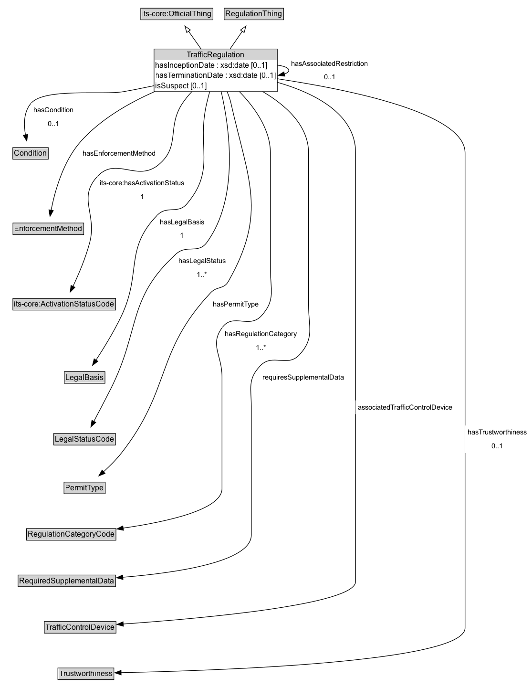

# TrafficRegulation

A traffic regulation is a rule having the force of law that is established by a regulator through a traffic regulation order.

**IRI**: `https://w3id.org/itsdata/regulation/v1/TrafficRegulation`

## Diagram

=== "SVG (interactive)"

    <!-- Generated by graphviz version 14.1.3 (20260303.0454)
     -->
    <!-- Pages: 1 -->
    <svg width="797pt" height="1049pt"
     viewBox="0.00 0.00 797.00 1049.00" xmlns="http://www.w3.org/2000/svg" xmlns:xlink="http://www.w3.org/1999/xlink">
    <g id="graph0" class="graph" transform="scale(1 1) rotate(0) translate(4 1044.75)">
    <polygon fill="white" stroke="none" points="-4,4 -4,-1044.75 793,-1044.75 793,4 -4,4"/>
    <g id="clust3" class="cluster">
    <title>cluster_associated</title>
    </g>
    <!-- its&#45;core_OfficialThing -->
    <g id="node1" class="node">
    <title>its&#45;core_OfficialThing</title>
    <g id="a_node1"><a xlink:href="https://w3id.org/itsdata/core/v1/OfficialThing" xlink:title="&lt;TABLE&gt;">
    <polygon fill="lightgray" stroke="none" points="215.25,-1014.62 215.25,-1030.88 326.75,-1030.88 326.75,-1014.62 215.25,-1014.62"/>
    <text xml:space="preserve" text-anchor="start" x="216.25" y="-1018.62" font-family="Arial" font-size="12.00">its&#45;core:OfficialThing</text>
    <polygon fill="none" stroke="black" points="214.25,-1013.62 214.25,-1031.88 327.75,-1031.88 327.75,-1013.62 214.25,-1013.62"/>
    </a>
    </g>
    </g>
    <!-- RegulationThing -->
    <g id="node2" class="node">
    <title>RegulationThing</title>
    <g id="a_node2"><a xlink:href="../RegulationThing" xlink:title="&lt;TABLE&gt;">
    <polygon fill="lightgray" stroke="none" points="346.38,-1014.62 346.38,-1030.88 437.62,-1030.88 437.62,-1014.62 346.38,-1014.62"/>
    <text xml:space="preserve" text-anchor="start" x="347.38" y="-1018.62" font-family="Arial" font-size="12.00">RegulationThing</text>
    <polygon fill="none" stroke="black" points="345.38,-1013.62 345.38,-1031.88 438.62,-1031.88 438.62,-1013.62 345.38,-1013.62"/>
    </a>
    </g>
    </g>
    <!-- TrafficRegulation -->
    <g id="node3" class="node">
    <title>TrafficRegulation</title>
    <g id="a_node3"><a xlink:href="../TrafficRegulation" xlink:title="&lt;TABLE&gt;">
    <polygon fill="lightgray" stroke="none" points="235.12,-950.5 235.12,-966.75 426.88,-966.75 426.88,-950.5 235.12,-950.5"/>
    <text xml:space="preserve" text-anchor="start" x="285.62" y="-954.5" font-family="Arial" font-size="12.00">TrafficRegulation</text>
    <text xml:space="preserve" text-anchor="start" x="236.12" y="-938.25" font-family="Arial" font-size="12.00">hasEnforcementMethod</text>
    <text xml:space="preserve" text-anchor="start" x="236.12" y="-922" font-family="Arial" font-size="12.00">hasInceptionDate : xsd:date [0..1]</text>
    <text xml:space="preserve" text-anchor="start" x="236.12" y="-905.75" font-family="Arial" font-size="12.00">hasLegalStatus [1..&#42;]</text>
    <text xml:space="preserve" text-anchor="start" x="236.12" y="-889.5" font-family="Arial" font-size="12.00">hasTerminationDate : xsd:date [0..1]</text>
    <polygon fill="none" stroke="black" points="234.12,-884.5 234.12,-967.75 427.88,-967.75 427.88,-884.5 234.12,-884.5"/>
    </a>
    </g>
    </g>
    <!-- TrafficRegulation&#45;&gt;its&#45;core_OfficialThing -->
    <g id="edge1" class="edge">
    <title>TrafficRegulation&#45;&gt;its&#45;core_OfficialThing</title>
    <path fill="none" stroke="black" d="M305.41,-967.48C299.44,-976.9 293.23,-986.69 287.76,-995.32"/>
    <polygon fill="none" stroke="black" points="284.94,-993.24 282.54,-1003.55 290.85,-996.98 284.94,-993.24"/>
    </g>
    <!-- TrafficRegulation&#45;&gt;RegulationThing -->
    <g id="edge2" class="edge">
    <title>TrafficRegulation&#45;&gt;RegulationThing</title>
    <path fill="none" stroke="black" d="M357.02,-967.48C363.09,-976.9 369.4,-986.69 374.96,-995.32"/>
    <polygon fill="none" stroke="black" points="371.91,-997.05 380.27,-1003.56 377.8,-993.26 371.91,-997.05"/>
    </g>
    <!-- TrafficRegulation&#45;&gt;TrafficRegulation -->
    <g id="edge16" class="edge">
    <title>TrafficRegulation&#45;&gt;TrafficRegulation</title>
    <path fill="none" stroke="black" d="M427.8,-935.68C438.77,-933.89 445.88,-930.7 445.88,-926.12 445.88,-923.33 443.23,-921.06 438.69,-919.31"/>
    <polygon fill="black" stroke="black" points="439.81,-915.98 429.26,-916.94 438.11,-922.77 439.81,-915.98"/>
    <polygon fill="white" stroke="none" points="445.88,-904.62 445.88,-947.62 574.62,-947.62 574.62,-904.62 445.88,-904.62"/>
    <text xml:space="preserve" text-anchor="start" x="449.88" y="-933.12" font-family="Arial" font-size="11.00">hasAssociatedRestriction</text>
    <text xml:space="preserve" text-anchor="start" x="501.25" y="-911.62" font-family="Arial" font-size="11.00">0..1</text>
    </g>
    <!-- Invis -->
    <!-- TrafficRegulation&#45;&gt;Invis -->
    <!-- Condition -->
    <g id="node5" class="node">
    <title>Condition</title>
    <g id="a_node5"><a xlink:href="../Condition" xlink:title="&lt;TABLE&gt;">
    <polygon fill="lightgray" stroke="none" points="35.12,-695.88 35.12,-712.12 88.88,-712.12 88.88,-695.88 35.12,-695.88"/>
    <text xml:space="preserve" text-anchor="start" x="36.12" y="-699.88" font-family="Arial" font-size="12.00">Condition</text>
    <polygon fill="none" stroke="black" points="34.12,-694.88 34.12,-713.12 89.88,-713.12 89.88,-694.88 34.12,-694.88"/>
    </a>
    </g>
    </g>
    <!-- TrafficRegulation&#45;&gt;Condition -->
    <g id="edge17" class="edge">
    <title>TrafficRegulation&#45;&gt;Condition</title>
    <path fill="none" stroke="black" d="M234.24,-909.91C194.66,-899.4 150.99,-881.71 120,-852 86.31,-819.7 71.78,-765.42 65.83,-732.63"/>
    <polygon fill="black" stroke="black" points="69.34,-732.39 64.25,-723.1 62.43,-733.54 69.34,-732.39"/>
    <polygon fill="white" stroke="none" points="120,-804.5 120,-847.5 191,-847.5 191,-804.5 120,-804.5"/>
    <text xml:space="preserve" text-anchor="start" x="124" y="-833" font-family="Arial" font-size="11.00">hasCondition</text>
    <text xml:space="preserve" text-anchor="start" x="146.5" y="-811.5" font-family="Arial" font-size="11.00">0..1</text>
    </g>
    <!-- its&#45;core_ActivationStatusCode -->
    <g id="node6" class="node">
    <title>its&#45;core_ActivationStatusCode</title>
    <g id="a_node6"><a xlink:href="https://w3id.org/itsdata/core/v1/ActivationStatusCode" xlink:title="&lt;TABLE&gt;">
    <polygon fill="lightgray" stroke="none" points="17.25,-595.38 17.25,-611.62 176.75,-611.62 176.75,-595.38 17.25,-595.38"/>
    <text xml:space="preserve" text-anchor="start" x="18.25" y="-599.38" font-family="Arial" font-size="12.00">its&#45;core:ActivationStatusCode</text>
    <polygon fill="none" stroke="black" points="16.25,-594.38 16.25,-612.62 177.75,-612.62 177.75,-594.38 16.25,-594.38"/>
    </a>
    </g>
    </g>
    <!-- TrafficRegulation&#45;&gt;its&#45;core_ActivationStatusCode -->
    <g id="edge15" class="edge">
    <title>TrafficRegulation&#45;&gt;its&#45;core_ActivationStatusCode</title>
    <path fill="none" stroke="black" d="M281.51,-884.71C274.25,-878.65 266.9,-872.45 260,-866.5 228.76,-839.59 227.4,-823.86 191,-804.5 161.97,-789.06 141.01,-811.14 119.25,-786.5 109.27,-775.2 101.87,-680.9 98.7,-632.67"/>
    <polygon fill="black" stroke="black" points="102.2,-632.48 98.07,-622.72 95.21,-632.92 102.2,-632.48"/>
    <polygon fill="white" stroke="none" points="119.25,-743.5 119.25,-786.5 260,-786.5 260,-743.5 119.25,-743.5"/>
    <text xml:space="preserve" text-anchor="start" x="123.25" y="-772" font-family="Arial" font-size="11.00">its&#45;core:hasActivationStatus</text>
    <text xml:space="preserve" text-anchor="start" x="186.62" y="-750.5" font-family="Arial" font-size="11.00">1</text>
    </g>
    <!-- LegalBasis -->
    <g id="node7" class="node">
    <title>LegalBasis</title>
    <g id="a_node7"><a xlink:href="../LegalBasis" xlink:title="&lt;TABLE&gt;">
    <polygon fill="lightgray" stroke="none" points="106,-494.88 106,-511.12 168,-511.12 168,-494.88 106,-494.88"/>
    <text xml:space="preserve" text-anchor="start" x="107" y="-498.88" font-family="Arial" font-size="12.00">LegalBasis</text>
    <polygon fill="none" stroke="black" points="105,-493.88 105,-512.12 169,-512.12 169,-493.88 105,-493.88"/>
    </a>
    </g>
    </g>
    <!-- TrafficRegulation&#45;&gt;LegalBasis -->
    <g id="edge13" class="edge">
    <title>TrafficRegulation&#45;&gt;LegalBasis</title>
    <path fill="none" stroke="black" d="M306.78,-884.69C303.62,-878.69 300.58,-872.51 298,-866.5 275.39,-813.94 297.84,-786.42 260,-743.5 247.17,-728.95 232.54,-740.5 220.25,-725.5 178.75,-674.87 212.43,-642.33 187,-582 179.16,-563.4 166.99,-544.29 156.62,-529.64"/>
    <polygon fill="black" stroke="black" points="159.73,-527.96 151.02,-521.93 154.06,-532.08 159.73,-527.96"/>
    <polygon fill="white" stroke="none" points="220.25,-682.5 220.25,-725.5 298,-725.5 298,-682.5 220.25,-682.5"/>
    <text xml:space="preserve" text-anchor="start" x="224.25" y="-711" font-family="Arial" font-size="11.00">hasLegalBasis</text>
    <text xml:space="preserve" text-anchor="start" x="256.12" y="-689.5" font-family="Arial" font-size="11.00">1</text>
    </g>
    <!-- PermitType -->
    <g id="node8" class="node">
    <title>PermitType</title>
    <g id="a_node8"><a xlink:href="../PermitType" xlink:title="&lt;TABLE&gt;">
    <polygon fill="lightgray" stroke="none" points="105.62,-394.38 105.62,-410.62 168.38,-410.62 168.38,-394.38 105.62,-394.38"/>
    <text xml:space="preserve" text-anchor="start" x="106.62" y="-398.38" font-family="Arial" font-size="12.00">PermitType</text>
    <polygon fill="none" stroke="black" points="104.62,-393.38 104.62,-411.62 169.38,-411.62 169.38,-393.38 104.62,-393.38"/>
    </a>
    </g>
    </g>
    <!-- TrafficRegulation&#45;&gt;PermitType -->
    <g id="edge18" class="edge">
    <title>TrafficRegulation&#45;&gt;PermitType</title>
    <path fill="none" stroke="black" d="M330.37,-884.63C328.64,-823.87 322.16,-712.99 298,-682.5 284.11,-664.97 266.93,-680.21 251,-664.5 219.83,-633.76 196.32,-521.26 178,-481.5 170.02,-464.17 160.08,-445.21 151.99,-430.32"/>
    <polygon fill="black" stroke="black" points="155.09,-428.69 147.2,-421.61 148.95,-432.06 155.09,-428.69"/>
    <polygon fill="white" stroke="none" points="251,-643 251,-664.5 331,-664.5 331,-643 251,-643"/>
    <text xml:space="preserve" text-anchor="start" x="255" y="-650" font-family="Arial" font-size="11.00">hasPermitType</text>
    </g>
    <!-- RegulationCategoryCode -->
    <g id="node9" class="node">
    <title>RegulationCategoryCode</title>
    <g id="a_node9"><a xlink:href="../RegulationCategoryCode" xlink:title="&lt;TABLE&gt;">
    <polygon fill="lightgray" stroke="none" points="38.75,-317.88 38.75,-334.12 177.25,-334.12 177.25,-317.88 38.75,-317.88"/>
    <text xml:space="preserve" text-anchor="start" x="39.75" y="-321.88" font-family="Arial" font-size="12.00">RegulationCategoryCode</text>
    <polygon fill="none" stroke="black" points="37.75,-316.88 37.75,-335.12 178.25,-335.12 178.25,-316.88 37.75,-316.88"/>
    </a>
    </g>
    </g>
    <!-- TrafficRegulation&#45;&gt;RegulationCategoryCode -->
    <g id="edge19" class="edge">
    <title>TrafficRegulation&#45;&gt;RegulationCategoryCode</title>
    <path fill="none" stroke="black" d="M342.69,-884.64C356.9,-826.87 374.06,-719.37 331,-643 323.87,-630.36 313.45,-635.8 303.75,-625 222.26,-534.21 256.11,-474.72 178,-381 168.46,-369.56 156.1,-359.03 144.42,-350.37"/>
    <polygon fill="black" stroke="black" points="146.67,-347.67 136.49,-344.72 142.6,-353.37 146.67,-347.67"/>
    <polygon fill="white" stroke="none" points="303.75,-582 303.75,-625 425,-625 425,-582 303.75,-582"/>
    <text xml:space="preserve" text-anchor="start" x="307.75" y="-610.5" font-family="Arial" font-size="11.00">hasRegulationCategory</text>
    <text xml:space="preserve" text-anchor="start" x="356.12" y="-589" font-family="Arial" font-size="11.00">1..&#42;</text>
    </g>
    <!-- RequiredSupplementalData -->
    <g id="node10" class="node">
    <title>RequiredSupplementalData</title>
    <g id="a_node10"><a xlink:href="../RequiredSupplementalData" xlink:title="&lt;TABLE&gt;">
    <polygon fill="lightgray" stroke="none" points="25.38,-244.88 25.38,-261.12 176.62,-261.12 176.62,-244.88 25.38,-244.88"/>
    <text xml:space="preserve" text-anchor="start" x="26.38" y="-248.88" font-family="Arial" font-size="12.00">RequiredSupplementalData</text>
    <polygon fill="none" stroke="black" points="24.38,-243.88 24.38,-262.12 177.62,-262.12 177.62,-243.88 24.38,-243.88"/>
    </a>
    </g>
    </g>
    <!-- TrafficRegulation&#45;&gt;RequiredSupplementalData -->
    <g id="edge20" class="edge">
    <title>TrafficRegulation&#45;&gt;RequiredSupplementalData</title>
    <path fill="none" stroke="black" d="M407.18,-884.61C425.05,-869.53 439,-850.31 439,-827 439,-827 439,-827 439,-652.75 439,-620.7 447.81,-604.53 425,-582 393.73,-551.11 356.07,-597.62 327.75,-564 310.57,-543.6 327,-530.67 327,-504 327,-504 327,-504 327,-325 327,-294.74 252.32,-275.81 188.81,-265.18"/>
    <polygon fill="black" stroke="black" points="189.44,-261.73 179.01,-263.59 188.32,-268.64 189.44,-261.73"/>
    <polygon fill="white" stroke="none" points="327.75,-542.5 327.75,-564 464,-564 464,-542.5 327.75,-542.5"/>
    <text xml:space="preserve" text-anchor="start" x="331.75" y="-549.5" font-family="Arial" font-size="11.00">requiresSupplementalData</text>
    </g>
    <!-- SuspectStatusCode -->
    <g id="node11" class="node">
    <title>SuspectStatusCode</title>
    <g id="a_node11"><a xlink:href="../SuspectStatusCode" xlink:title="&lt;TABLE&gt;">
    <polygon fill="lightgray" stroke="none" points="67.75,-171.88 67.75,-188.12 176.25,-188.12 176.25,-171.88 67.75,-171.88"/>
    <text xml:space="preserve" text-anchor="start" x="68.75" y="-175.88" font-family="Arial" font-size="12.00">SuspectStatusCode</text>
    <polygon fill="none" stroke="black" points="66.75,-170.88 66.75,-189.12 177.25,-189.12 177.25,-170.88 66.75,-170.88"/>
    </a>
    </g>
    </g>
    <!-- TrafficRegulation&#45;&gt;SuspectStatusCode -->
    <g id="edge22" class="edge">
    <title>TrafficRegulation&#45;&gt;SuspectStatusCode</title>
    <path fill="none" stroke="black" d="M427.82,-894.63C455.34,-879.59 478,-857.84 478,-827 478,-827 478,-827 478,-602.5 478,-575.12 476.78,-566.72 464,-542.5 458.93,-532.9 452.43,-534.17 447.5,-524.5 432.9,-495.91 433,-485.85 433,-453.75 433,-453.75 433,-453.75 433,-252 433,-202.28 279.98,-187.37 188.61,-182.91"/>
    <polygon fill="black" stroke="black" points="188.9,-179.42 178.75,-182.46 188.58,-186.41 188.9,-179.42"/>
    <polygon fill="white" stroke="none" points="447.5,-481.5 447.5,-524.5 502,-524.5 502,-481.5 447.5,-481.5"/>
    <text xml:space="preserve" text-anchor="start" x="451.5" y="-510" font-family="Arial" font-size="11.00">isSuspect</text>
    <text xml:space="preserve" text-anchor="start" x="465.75" y="-488.5" font-family="Arial" font-size="11.00">0..1</text>
    </g>
    <!-- TrafficControlDevice -->
    <g id="node12" class="node">
    <title>TrafficControlDevice</title>
    <g id="a_node12"><a xlink:href="../TrafficControlDevice" xlink:title="&lt;TABLE&gt;">
    <polygon fill="lightgray" stroke="none" points="66.62,-98.88 66.62,-115.12 177.38,-115.12 177.38,-98.88 66.62,-98.88"/>
    <text xml:space="preserve" text-anchor="start" x="67.62" y="-102.88" font-family="Arial" font-size="12.00">TrafficControlDevice</text>
    <polygon fill="none" stroke="black" points="65.62,-97.88 65.62,-116.12 178.38,-116.12 178.38,-97.88 65.62,-97.88"/>
    </a>
    </g>
    </g>
    <!-- TrafficRegulation&#45;&gt;TrafficControlDevice -->
    <g id="edge14" class="edge">
    <title>TrafficRegulation&#45;&gt;TrafficControlDevice</title>
    <path fill="none" stroke="black" d="M427.83,-909.72C472.6,-896.51 516,-872.08 516,-827 516,-827 516,-827 516,-179 516,-146.2 301.78,-123.17 189.25,-113.33"/>
    <polygon fill="black" stroke="black" points="189.8,-109.87 179.54,-112.5 189.2,-116.84 189.8,-109.87"/>
    <polygon fill="white" stroke="none" points="516,-442 516,-463.5 672.5,-463.5 672.5,-442 516,-442"/>
    <text xml:space="preserve" text-anchor="start" x="520" y="-449" font-family="Arial" font-size="11.00">associatedTrafficControlDevice</text>
    </g>
    <!-- Trustworthiness -->
    <g id="node13" class="node">
    <title>Trustworthiness</title>
    <g id="a_node13"><a xlink:href="../Trustworthiness" xlink:title="&lt;TABLE&gt;">
    <polygon fill="lightgray" stroke="none" points="85,-25.88 85,-42.12 171,-42.12 171,-25.88 85,-25.88"/>
    <text xml:space="preserve" text-anchor="start" x="86" y="-29.88" font-family="Arial" font-size="12.00">Trustworthiness</text>
    <polygon fill="none" stroke="black" points="84,-24.88 84,-43.12 172,-43.12 172,-24.88 84,-24.88"/>
    </a>
    </g>
    </g>
    <!-- TrafficRegulation&#45;&gt;Trustworthiness -->
    <g id="edge21" class="edge">
    <title>TrafficRegulation&#45;&gt;Trustworthiness</title>
    <path fill="none" stroke="black" d="M427.61,-917.55C533.34,-906.53 688,-881.15 688,-827 688,-827 688,-827 688,-106 688,-55.48 324.67,-40.28 183.32,-36.28"/>
    <polygon fill="black" stroke="black" points="183.55,-32.78 173.46,-36.01 183.36,-39.78 183.55,-32.78"/>
    <polygon fill="white" stroke="none" points="688,-381 688,-424 789,-424 789,-381 688,-381"/>
    <text xml:space="preserve" text-anchor="start" x="692" y="-409.5" font-family="Arial" font-size="11.00">hasTrustworthiness</text>
    <text xml:space="preserve" text-anchor="start" x="729.5" y="-388" font-family="Arial" font-size="11.00">0..1</text>
    </g>
    <!-- Invis&#45;&gt;Condition -->
    <!-- Condition&#45;&gt;its&#45;core_ActivationStatusCode -->
    <!-- its&#45;core_ActivationStatusCode&#45;&gt;LegalBasis -->
    <!-- LegalBasis&#45;&gt;PermitType -->
    <!-- PermitType&#45;&gt;RegulationCategoryCode -->
    <!-- RegulationCategoryCode&#45;&gt;RequiredSupplementalData -->
    <!-- RequiredSupplementalData&#45;&gt;SuspectStatusCode -->
    <!-- SuspectStatusCode&#45;&gt;TrafficControlDevice -->
    <!-- TrafficControlDevice&#45;&gt;Trustworthiness -->
    </g>
    </svg>

=== "PNG"

    

## Specializations of TrafficRegulation

| Class | Description |
|-------|-------------|
| [Coded Pair Regulation](CodedPairRegulation.md) | A restriction defined by a code. |
| [Coded Regulation](CodedRegulation.md) | A restriction defined by a code. |
| [Coded Regulation With Fee](CodedRegulationWithFee.md) | A condition defined by a code. |
| [Coded Regulation With Threshold](CodedRegulationWithThreshold.md) | A restriction defined by a code coupled with a threshold value. |
| [Textual Regulation](TextualRegulation.md) | A textual regulation is a rule having the force of law that is established by a regulator through a traffic regulation order. |

## Formalization for TrafficRegulation

| Property | Constraint |
|----------|------------|
| [associatedTrafficControlDevice](../properties/associatedTrafficControlDevice.md) | only [TrafficControlDevice](https://w3id.org/itsdata/regulation/v1/TrafficControlDevice) |
| [hasAssociatedRestriction](../properties/hasAssociatedRestriction.md) | max 1 [TrafficRegulation](https://w3id.org/itsdata/regulation/v1/TrafficRegulation) |
| [hasCondition](../properties/hasCondition.md) | max 1 [Condition](https://w3id.org/itsdata/regulation/v1/Condition) |
| [hasInceptionDate](../properties/hasInceptionDate.md) | max 1 xsd:date |
| [hasLegalBasis](../properties/hasLegalBasis.md) | exactly 1 |
| [hasPermitType](../properties/hasPermitType.md) | only [PermitType](https://w3id.org/itsdata/regulation/v1/PermitType) |
| [hasRegulationCategory](../properties/hasRegulationCategory.md) | min 1 [RegulationCategoryCode](https://w3id.org/itsdata/regulation/v1/RegulationCategoryCode) |
| [hasTerminationDate](../properties/hasTerminationDate.md) | max 1 xsd:date |
| [hasTrustworthiness](../properties/hasTrustworthiness.md) | max 1 [Trustworthiness](https://w3id.org/itsdata/regulation/v1/Trustworthiness) |
| [isSuspect](../properties/isSuspect.md) | max 1 [SuspectStatusCode](https://w3id.org/itsdata/regulation/v1/SuspectStatusCode) |
| [its-core:hasActivationStatus](https://w3id.org/itsdata/core/v1/hasActivationStatus) | exactly 1 [its-core:ActivationStatusCode](https://w3id.org/itsdata/core/v1/ActivationStatusCode) |
| [requiresSupplementalData](../properties/requiresSupplementalData.md) | only [RequiredSupplementalData](https://w3id.org/itsdata/regulation/v1/RequiredSupplementalData) |
| hasEnforcementMethod | only [EnforcementMethod](https://w3id.org/itsdata/regulation/v1/EnforcementMethod) |
| hasLegalStatus | min 1 [LegalStatusCode](https://w3id.org/itsdata/regulation/v1/LegalStatusCode) |
| subClassOf | [RegulationThing](RegulationThing.md) |
| subClassOf | [its-core:OfficialThing](https://w3id.org/itsdata/core/v1/OfficialThing) |

## Other annotations

| Property | Value |
|----------|-------|
| ReqView ID | its-regulation-59 |
| [dash:abstract](https://w3id.org/citydata/imported/dash/abstract) | true |
| [skos:editorialNote](https://w3id.org/citydata/imported/skos/editorialNote) | The latest release of DATEX-II assigns a legalBasis to each condition rather than to the regulation. This seems odd; I have added a link for both in this model. |
| [skos:editorsNote](https://w3id.org/citydata/imported/skos/editorsNote) | It is unclear if PermitInformation needs to be associated directly with TrafficRegulation and why. It seems as if PermitCondition is a more appropriate way to describe the association. |

