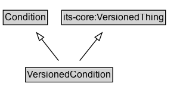

# VersionedCondition

A specific version of a condition that can be referenced by a ConditionReference.

**IRI**: `https://w3id.org/itsdata/regulation/v1/VersionedCondition`

## Diagram

=== "SVG (interactive)"

    <!-- Generated by graphviz version 14.1.3 (20260303.0454)
     -->
    <!-- Pages: 1 -->
    <svg width="234pt" height="132pt"
     viewBox="0.00 0.00 234.00 132.00" xmlns="http://www.w3.org/2000/svg" xmlns:xlink="http://www.w3.org/1999/xlink">
    <g id="graph0" class="graph" transform="scale(1 1) rotate(0) translate(4 128)">
    <polygon fill="white" stroke="none" points="-4,4 -4,-128 229.88,-128 229.88,4 -4,4"/>
    <g id="clust3" class="cluster">
    <title>cluster_associated</title>
    </g>
    <!-- Condition -->
    <g id="node1" class="node">
    <title>Condition</title>
    <g id="a_node1"><a xlink:href="../Condition" xlink:title="&lt;TABLE&gt;">
    <polygon fill="lightgray" stroke="none" points="1,-97.88 1,-114.12 54.75,-114.12 54.75,-97.88 1,-97.88"/>
    <text xml:space="preserve" text-anchor="start" x="2" y="-101.88" font-family="Arial" font-size="12.00">Condition</text>
    <polygon fill="none" stroke="black" points="0,-96.88 0,-115.12 55.75,-115.12 55.75,-96.88 0,-96.88"/>
    </a>
    </g>
    </g>
    <!-- its&#45;core_VersionedThing -->
    <g id="node2" class="node">
    <title>its&#45;core_VersionedThing</title>
    <g id="a_node2"><a xlink:href="https://w3id.org/itsdata/core/v1/VersionedThing" xlink:title="&lt;TABLE&gt;">
    <polygon fill="lightgray" stroke="none" points="74.5,-97.88 74.5,-114.12 203.25,-114.12 203.25,-97.88 74.5,-97.88"/>
    <text xml:space="preserve" text-anchor="start" x="75.5" y="-101.88" font-family="Arial" font-size="12.00">its&#45;core:VersionedThing</text>
    <polygon fill="none" stroke="black" points="73.5,-96.88 73.5,-115.12 204.25,-115.12 204.25,-96.88 73.5,-96.88"/>
    </a>
    </g>
    </g>
    <!-- VersionedCondition -->
    <g id="node3" class="node">
    <title>VersionedCondition</title>
    <g id="a_node3"><a xlink:href="../VersionedCondition" xlink:title="&lt;TABLE&gt;">
    <polygon fill="lightgray" stroke="none" points="29,-25.88 29,-42.12 136.75,-42.12 136.75,-25.88 29,-25.88"/>
    <text xml:space="preserve" text-anchor="start" x="30" y="-29.88" font-family="Arial" font-size="12.00">VersionedCondition</text>
    <polygon fill="none" stroke="black" points="28,-24.88 28,-43.12 137.75,-43.12 137.75,-24.88 28,-24.88"/>
    </a>
    </g>
    </g>
    <!-- VersionedCondition&#45;&gt;Condition -->
    <g id="edge1" class="edge">
    <title>VersionedCondition&#45;&gt;Condition</title>
    <path fill="none" stroke="black" d="M69.68,-51.79C63.22,-60.02 55.29,-70.11 48.08,-79.29"/>
    <polygon fill="none" stroke="black" points="45.55,-76.84 42.12,-86.86 51.05,-81.16 45.55,-76.84"/>
    </g>
    <!-- VersionedCondition&#45;&gt;its&#45;core_VersionedThing -->
    <g id="edge2" class="edge">
    <title>VersionedCondition&#45;&gt;its&#45;core_VersionedThing</title>
    <path fill="none" stroke="black" d="M96.31,-51.79C102.89,-60.02 110.97,-70.11 118.31,-79.29"/>
    <polygon fill="none" stroke="black" points="115.39,-81.25 124.37,-86.87 120.86,-76.88 115.39,-81.25"/>
    </g>
    <!-- Invis -->
    </g>
    </svg>

=== "PNG"

    

## Formalization for VersionedCondition

| Property | Constraint |
|----------|------------|
| subClassOf | [Condition](Condition.md) |
| subClassOf | [its-core:VersionedThing](https://w3id.org/itsdata/core/v1/VersionedThing) |

## Other annotations

| Property | Value |
|----------|-------|
| ReqView ID | its-regulation-65 |
| [dash:abstract](https://w3id.org/citydata/imported/dash/abstract) | true |
| [skos:editorialNote](https://w3id.org/citydata/imported/skos/editorialNote) | DATEX-II defines a ConditionReference class, but it seems incomplete as it references a non-existent PredefinedCondition class. |

